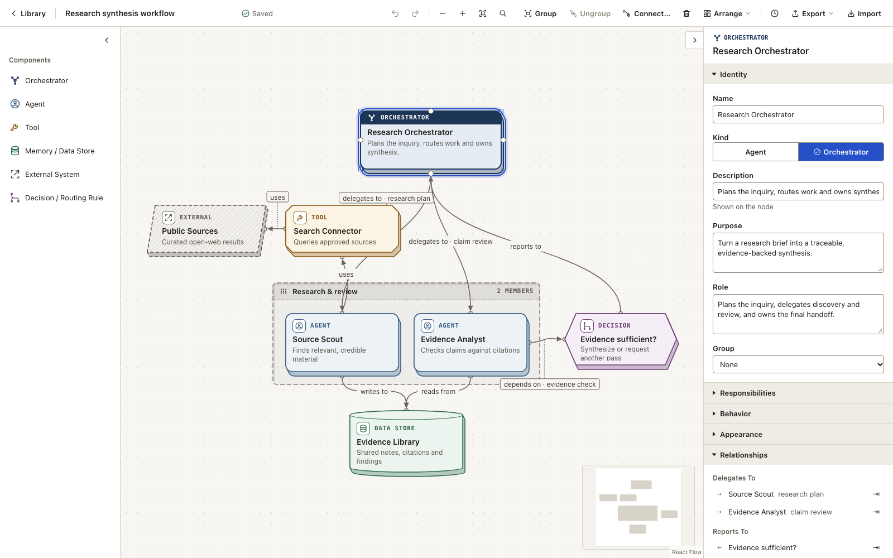

# Swarm Architecturer

**A local-first visual editor for documenting AI-agent architectures.**

Swarm Architecturer gives a multi-agent system a shared, inspectable map: typed components on a canvas, semantic relationships, and the behavioral detail that usually gets lost between code, chat, and slide decks. It is a documentation tool, not an agent runtime, workflow engine, or LLM client.

Built for AI engineers, software architects, and researchers who need to document how an agent system is structured and expected to behave.

No account. No application backend. No API key. Open source under MIT.

**[Open the app → swarm-architecturer.vercel.app/app/](https://swarm-architecturer.vercel.app/app/)** · [Website](https://swarm-architecturer.vercel.app)

[Use it online](#use-it-online) · [Quickstart](#quickstart) · [Feature tour](#feature-tour) · [Your data](#how-your-data-works) · [Documentation](#documentation) · [Contributing](#contributing)



*Structure on the canvas. Behavior in the inspector. Everything stays in your browser.*

## Why Swarm Architecturer?

Agent systems are hard to explain. Prose hides the structure, framework code ties the design to one implementation, and generic diagrams lose the difference between an agent, a tool, and a data store. The result is an architecture that exists in pieces and drifts as the system evolves.

Swarm Architecturer treats the architecture itself as the artifact:

- **Structure on the canvas.** Agents, orchestrators, tools, memories, external systems, and routing decisions are first-class components with meaningful relationships.
- **Behavior in the inspector.** Purpose, responsibilities, boundaries, delegation, outputs, and failure handling sit next to the diagram without cluttering it.
- **Portable by default.** Canonical JSON, readable Markdown, and PNG export mean the work can be reviewed, versioned, and shared outside the tool.
- **Local-first by design.** The app runs in the browser and stores data on the device. There is no service to sign up for and no architecture data sent to a server.

The goal is not to run the system. It is to make it legible before, during, and after implementation. As an open-source project, the vocabulary, schema, and implementation are available to inspect, self-host, and adapt without a vendor dependency.

## What it is — and what it is not

| It is | It is not |
| --- | --- |
| A visual documentation tool for AI-agent architectures | An agent runtime, orchestration framework, or workflow engine |
| A framework-agnostic vocabulary for components and relationships | An LLM client, prompt runner, or model gateway |
| A structured place for behavior, notes, and design rationale | A simulator, observability platform, or debugging tool |
| A static web app with open JSON, Markdown, and PNG artifacts | A cloud service, account system, or real-time collaboration product |

Relationships in Swarm Architecturer are **semantic documentation**. Arrows describe how components relate; they do not imply execution order, control flow, or data flow. Behavioral fields are plain text and Markdown, not an executable DSL.

## Feature tour

### Model the system, not just the boxes

The palette provides agent-specific building blocks:

- **Agent** — an autonomous participant with optional purpose, role, responsibilities, boundaries, activation, rules, delegation, outputs, and failure handling.
- **Orchestrator** — an Agent subtype for coordination, routing, and delegation, with the same schema and a distinct visual treatment.
- **Tool** — an invocable capability, with inputs, outputs, and a technical reference.
- **Memory / Data Store** — a passive information resource, with store kind, access scope, contents, and access notes.
- **External System** — a system outside the modeled boundary, with ownership notes and a reference link.
- **Decision / Routing Rule** — a notable condition and its outcomes, documented but not executed.

Connect components with ten semantic relationship types: Delegates To, Supervises, Uses, Reads From, Writes To, Shares Context With, Reports To, Hands Off To, Depends On, and Generic. Predefined types fix their direction; Generic relationships can be directed or undirected. Labels and descriptions make the relation readable without opening a document.

### Think on the canvas

- Add components by clicking the palette or dragging them onto the canvas.
- Connect through the relationship dialog or from a component's ports.
- Group related components into named, non-executable containers. Moving a group moves its members.
- Use **Quick Find** (`Ctrl/Cmd+K` or `/`) to search by name, type, or group, then select and reveal the result.
- **Arrange** with align, distribute, and tidy actions. These change geometry only; relationships and group membership stay intact.
- Color components individually or as a multi-selection. Color is presentation, not architecture semantics.
- Undo and redo changes, duplicate selections, and delete with a confirmation that explains what will be removed.

The editor autosaves locally and shows its save state in the toolbar. A failed save stays visible with a retry action.

### Put behavior where it belongs

The inspector adapts to what is selected. Agents and orchestrators expose structured behavioral fields; tools, data stores, external systems, and decisions expose fields relevant to their role. Groups and architecture-level details have their own inspectors.

Notes support Markdown with an Edit/Preview toggle. User links are shown as links, while raw HTML and remote images are deliberately not rendered. A component's relationship list is read-only and derived from the graph, so there is one source of truth.

### Leave with useful artifacts

- **JSON** — canonical `schemaVersion: 2` files for backup, review, and re-import. Imports are validated before anything is saved, create a new architecture rather than overwriting one, and accept v1 files through migration.
- **Markdown** — a deterministic human-readable document covering the summary, groups, components, behavior, notes, and relationships.
- **PNG** — the whole diagram rendered as an image for reviews, issues, or presentations.
- **Versions** — browser-local automatic, manual, and pre-restore snapshots with restore and undo. Versions are a local safety net, not portable version control.

## Typical workflow

1. Create an architecture in the library.
2. Add an orchestrator, agents, tools, memory, external systems, or decisions.
3. Connect them with typed relationships.
4. Document purpose, behavior, boundaries, and failure handling in the inspector; add Markdown notes and links where they help.
5. Group related parts, then use Quick Find and Arrange to keep the diagram readable.
6. Export JSON for a durable backup, Markdown for a review document, or PNG for a visual share.

## How your data works

Swarm Architecturer is built around **self-contained, export-first use**. Each browser is its own workspace: you open the app, model an architecture, and take it with you as a file. There is no server copy, account, or sync behind it.

### Where your work is stored

Your architectures are saved **only in your browser's local storage** (IndexedDB, part of the browser's site data, for the address you opened). Autosave writes every change there. Nothing is uploaded: the site only delivers the app's static files, and there are no analytics, telemetry, external fonts, or runtime AI calls.

That means your work lives in **that browser, that profile, and that address**. Opening the app in another browser, another device, a private window, or a different address (for example a local `npm run dev` copy) starts with an empty library.

### To avoid losing your work

> [!IMPORTANT]
> **Your browser is not a backup.** Your architectures disappear if the browser's site data is cleared. This can happen when you clear browsing data such as "cookies and site data" or cache, reset the browser, or remove the profile. Browsers can also free up storage on their own; Safari, for example, removes data for sites you have not visited in about 7 days, unless the site is added to the Home Screen.

- **Export JSON regularly** and keep the file somewhere safe (a project folder, a repository, cloud storage). JSON is the only format that restores a full architecture.
- **Don't clear this site's browsing data** while you have unexported work.
- **Export before switching** browsers, devices, or addresses, then import the JSON on the other side.

### Other consequences

- **JSON is the portable source of truth.** It can restore an architecture on another device or browser. Markdown and PNG are for reading and sharing, not round-tripping.
- **Versions stay local.** Automatic, manual, and pre-restore snapshots live in the same browser storage. They are not included in JSON export and are not copied to imported or duplicated architectures.
- **There is no real-time sync or cloud collaboration.** Two tabs can open the same architecture, but the app warns you; writes are last-write-wins, with no merge.
- **Sharing is asynchronous.** Send JSON when someone needs to edit, or Markdown/PNG when someone needs to review.

The production build is static and can be served from any static host.

## Use it online

The hosted version runs entirely in your browser — nothing to install, no sign-up:

- **Editor:** [swarm-architecturer.vercel.app/app/](https://swarm-architecturer.vercel.app/app/)
- **Website:** [swarm-architecturer.vercel.app](https://swarm-architecturer.vercel.app)

Your work is saved only in that browser, for that address. **Export JSON to keep it**, and don't clear the site's browsing data, or your architectures will be lost. See [How your data works](#how-your-data-works).

## Quickstart

To run it from source instead: Swarm Architecturer is pre-1.0 (`0.0.0`) and has no tagged release yet; these steps run the current source.

### Requirements

- **Node.js 22.12 or newer** recommended. The installed Vite release supports `^20.19.0 || >=22.12.0`; a current Node 22 LTS or newer is the simplest choice.
- npm (included with Node.js).

### Run locally

```bash
git clone https://github.com/TobiasArg/SWA.git
cd SWA
npm ci
npm run dev
```

Open the local URL printed by Vite: the landing page is served at `/` and the editor at `/app/`. No environment file, account, or API key is required.

### Build and preview

```bash
npm run build
npm run preview
```

The production output is a static `dist/` directory. Deploy it to any static host at the site root (the default Vite configuration); the landing page is served at `/` and the editor at `/app/`. There is no application server. The hosted site is deployed to Vercel with the settings in `vercel.json`, which also redirects `/app` to `/app/`.

## Checks

Run the core quality checks from the repository root:

```bash
npm test
npm run typecheck
npm run lint
npm run build
npm run check:bundle
```

The end-to-end suite needs Playwright browsers and a production build:

```bash
npx playwright install
npm run build
CI=1 npm run e2e
```

Playwright runs the full suite in Chromium and the `@smoke` suite in Firefox and WebKit. `CI=1` makes the run use a fresh preview server and CI retry behavior. Focused commands are also available: `npm run e2e:chromium` and `npm run e2e:smoke`.

## Project layout

```text
src/domain/       Schema, commands, validation, serialization
src/editor/       Editor store, history, actions, arrange logic
src/canvas/       React Flow canvas, edges, groups, ports
src/inspector/    Type-aware property panels and Markdown notes
src/persistence/  IndexedDB repository, autosave, versions
src/io/           JSON import/export; Markdown and PNG export
e2e/              Playwright scenarios and accessibility checks
```

Built with React, TypeScript, Vite, React Flow (`@xyflow/react`), Zod, and `idb`. Unit and component tests use Vitest and Testing Library; end-to-end tests use Playwright.

## Documentation

- [Product concept](PRODUCT_CONCEPT_V1.1.md) — positioning, component vocabulary, behavior model, and non-goals.
- [Technical design](TECHNICAL_DESIGN.md) — domain contracts, persistence, import/export, security, and test strategy.
- [Roadmap v2 design](ROADMAP_V2_DESIGN.md) — shipped interaction details for Quick Find, Arrange, color, versions, and quality work.
- [Third-party runtime licenses](public/THIRD_PARTY_LICENSES.md) — notices for the dependencies shipped with the app.

The design documents include historical planning context; the code and its tests are the final source of truth for current behavior.

## Contributing

Issues and pull requests are welcome. This project benefits from focused fixes, documentation improvements, tests, and thoughtful UX work as much as from large features.

- Open an issue before a substantial change so the approach can be discussed first.
- For a bug report, include what you expected, what happened, steps to reproduce, and the browser and Node.js versions you used.
- Keep pull requests scoped. Add or update tests for behavior changes, and run the relevant checks locally.
- Preserve the core product boundary: the app documents architectures and does not execute them or call AI services.
- Contributions are accepted under the project's MIT license.

A CI workflow is not configured in this repository yet, so please include the commands you ran in your pull request. If a report could expose users, avoid posting exploit details publicly.

## License

Swarm Architecturer is released under the [MIT License](LICENSE).

Copyright © 2026 TobiasArg. Third-party runtime dependencies retain their own licenses; see [third-party licenses](public/THIRD_PARTY_LICENSES.md).
